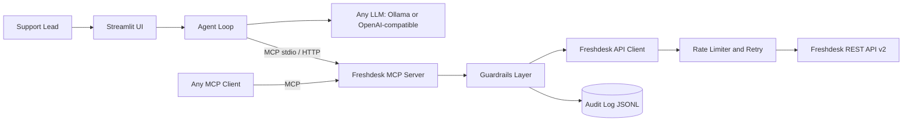

# Freshdesk MCP Connector

**A private, guard-railed [Model Context Protocol](https://modelcontextprotocol.io) connector that lets an AI agent read Freshdesk tickets, analyzes them and suggests set of human-approved changes. It ships with a Support Triage Copilot (Streamlit UI) that shows the connector solving a real merchant problem.**

Built for Indian SMB merchants who take payments through Razorpay and run support on Freshdesk.

---

## Contents

1. [The problem](#the-problem)
2. [How the five deliverables are covered](#how-the-five-deliverables-are-covered)
3. [Architecture](#architecture)
4. [Quick start](#quick-start)
5. [Tool reference](#tool-reference)
6. [Rate-limit handling](#rate-limit-handling)
7. [Guardrails and security](#guardrails-and-security)
8. [Support Triage Copilot](#support-triage-copilot)
9. [Choosing an LLM](#choosing-an-llm)
10. [Configuration](#configuration)
11. [Testing and verification status](#testing-and-verification-status)
12. [Relationship to Razorpay Agent Studio](#relationship-to-razorpay-agent-studio)
13. [Project structure](#project-structure)
14. [Roadmap](#roadmap)

---

## The problem

Merchants receive a steady stream of payment-related support tickets: *"money deducted but order not confirmed"*, *"refund not received"*, *"UPI collect failing"*, *"settlement delayed"*. These are urgent because money is stuck, yet they sit in the same queue as invoice requests and spam. Agents spend their time reading, tagging and re-prioritising tickets by hand, and the urgent ones get buried.

This project gives an agent safe, auditable access to Freshdesk so it can:

- read and search tickets and their conversations,
- classify each ticket (payment failure, refund, settlement, shipping, invoice, spam, other) and rate its urgency,
- summarise a ticket for a busy human,
- **propose** a private note, tags and a priority raise, which a person approves before anything is written.

---

## How the five deliverables are covered


| #   | Deliverable                                         | How it is covered                                                                                                                                                                                                                                                                                                                                                                                                                                                                                 | Where to look                                                                                                                      |
| --- | --------------------------------------------------- | ------------------------------------------------------------------------------------------------------------------------------------------------------------------------------------------------------------------------------------------------------------------------------------------------------------------------------------------------------------------------------------------------------------------------------------------------------------------------------------------------- | ---------------------------------------------------------------------------------------------------------------------------------- |
| 1   | **Working OAuth or API-key auth flow**              | Freshdesk authenticates with API keys, so the connector uses the key as the Basic-auth username (password `X`). Credentials come from environment variables only. On startup the server calls `GET /agents/me` and exits with a clear message if auth fails. 401 and 403 responses become readable errors. The key is never logged or returned by a tool. OAuth is not applicable to Freshdesk; the production path for OAuth tools is described [below](#relationship-to-razorpay-agent-studio). | `[client.py](src/freshdesk_mcp/client.py)`, `[config.py](src/freshdesk_mcp/config.py)`, `[server.py](src/freshdesk_mcp/server.py)` |
| 2   | **The right primitives (list, get, search, write)** | Ten MCP tools: **list** (`list_tickets`, `list_ticket_conversations`, `list_ticket_fields`), **get** (`get_ticket`, `get_contact`, `get_connector_status`), **search** (`search_tickets` with a validated query grammar, `search_contacts`), and two deliberately narrow **writes** (`add_private_note`, `update_ticket_triage`). There are no delete, merge, close or customer-reply tools.                                                                                                      | `[tools/](src/freshdesk_mcp/tools)`, [tool reference](#tool-reference)                                                             |
| 3   | **Rate-limit handling**                             | Proactive: a per-minute token bucket, a concurrency cap and tracking of `X-Ratelimit-Remaining`. Reactive: `Retry-After` is honoured on HTTP 429, with exponential backoff and jitter on 5xx for GETs. When retries are exhausted the tool returns a structured `rate_limited` error with `retry_after_seconds` so the agent can react. POSTs are never auto-retried after a failure.                                                                                                             | `[ratelimit.py](src/freshdesk_mcp/ratelimit.py)`, `[client.py](src/freshdesk_mcp/client.py)`, [details](#rate-limit-handling)      |
| 4   | **An MCP tool spec or equivalent**                  | `[docs/tool_spec.json](docs/tool_spec.json)` is generated from the registered tools (`scripts/gen_tool_spec.py`), so it cannot drift from the code. It carries each tool's name, description, JSON input schema, read or write class and MCP annotations (`readOnlyHint`, `destructiveHint`, `idempotentHint`). `[docs/TOOL_SPEC.md](docs/TOOL_SPEC.md)` is the human-readable version with outputs, error codes and the Freshdesk endpoint behind each tool.                                     | `[docs/TOOL_SPEC.md](docs/TOOL_SPEC.md)`, `[docs/tool_spec.json](docs/tool_spec.json)`                                             |
| 5   | **A short doc on what an agent can and can't do**   | One page covering capabilities, explicit non-goals, operating limits and security notes.                                                                                                                                                                                                                                                                                                                                                                                                          | `[docs/CAPABILITIES.md](docs/CAPABILITIES.md)`                                                                                     |


**Beyond the brief:** PII masking, prompt-injection containment, a server-side write gate with dry-run and human confirmation, an audit log, the Triage Copilot with a Streamlit UI, a provider-agnostic LLM layer, and a seed-data script.

---

## Architecture




The connector (`src/freshdesk_mcp`) has no dependency on the UI or on any LLM. The Streamlit app is simply one MCP client that spawns the server over stdio, so it exercises the same path as Claude Desktop, Cursor or any other client. See `[docs/ARCHITECTURE.md](docs/ARCHITECTURE.md)`.

---

## Quick start

Requirements: Python 3.11+ and [uv](https://docs.astral.sh/uv/).

```bash
# 1. Install
uv sync --extra dev

# 2. Configure (Freshdesk: Profile Settings -> API Key)
cp .env.example .env
#    set FRESHDESK_DOMAIN=yourcompany.freshdesk.com and FRESHDESK_API_KEY=...

# 3. (Optional) seed 15 Razorpay-themed demo tickets into a trial account
uv run python scripts/seed_tickets.py --dry-run   # preview
uv run python scripts/seed_tickets.py             # create (writes to your account)

# 4. Run the UI (needs an LLM, see "Choosing an LLM")
uv run streamlit run app/streamlit_app.py
```

### Run the MCP server on its own

```bash
uv run freshdesk-mcp                               # stdio
uv run freshdesk-mcp --transport streamable-http   # HTTP
npx @modelcontextprotocol/inspector uv run freshdesk-mcp   # explore tools interactively
```

Register it in Claude Desktop, Cursor or any MCP client:

```json
{
  "mcpServers": {
    "freshdesk": {
      "command": "uv",
      "args": ["run", "--directory", "/path/to/razorpay-freshdesk-mcp-connector", "freshdesk-mcp"],
      "env": { "FRESHDESK_DOMAIN": "acme.freshdesk.com", "FRESHDESK_API_KEY": "..." }
    }
  }
}
```

---

## Tool reference

Full schemas: `[docs/tool_spec.json](docs/tool_spec.json)`. Details and error codes: `[docs/TOOL_SPEC.md](docs/TOOL_SPEC.md)`.

**Read tools** (`readOnlyHint = true`, always available)


| Tool                             | Purpose                                                                                                    |
| -------------------------------- | ---------------------------------------------------------------------------------------------------------- |
| `list_tickets`                   | List tickets newest first; filter by `status`, `priority`, `updated_since`; paginated (max 30 per page).   |
| `get_ticket`                     | One ticket with its description, optionally with the conversation thread.                                  |
| `search_tickets`                 | Freshdesk query language, e.g. `status:2 AND tag:'refund'`. Terms are validated against a field whitelist. |
| `list_ticket_conversations`      | Replies and notes on a ticket.                                                                             |
| `get_contact`, `search_contacts` | Look up a customer by id, exact email or phone (masked).                                                   |
| `list_ticket_fields`             | Valid status and priority codes plus custom fields (cached for 10 minutes).                                |
| `get_connector_status`           | Version, authenticated identity, write mode, rate-limit budget, retries performed.                         |


**Write tools** (off by default; need `WRITE_ENABLED=true` on the server)


| Tool                   | Purpose                                                                                                                                    |
| ---------------------- | ------------------------------------------------------------------------------------------------------------------------------------------ |
| `add_private_note`     | Adds an **internal** note. `private=true` is hard-coded, so it is never visible to the customer and never sends email.                     |
| `update_ticket_triage` | Changes only priority, status (not Closed) and adds tags. Tags are merged with existing ones. The dry run returns a before and after diff. |


Both write tools default to `dry_run=true`. A real write requires `dry_run=false` **and** `confirm=true`, and `confirm` must come from a human approval step.

---

## Rate-limit handling

Freshdesk limits are plan-based and per minute. A trial account reports **50 requests per minute** in the `X-Ratelimit-Total` header.


| Mechanism             | Behaviour                                                                                                      |
| --------------------- | -------------------------------------------------------------------------------------------------------------- |
| Token bucket          | `RATE_LIMIT_PER_MIN` (default 40) keeps the connector below the plan limit.                                    |
| Concurrency cap       | At most `MAX_CONCURRENCY` (default 3) requests in flight.                                                      |
| Header tracking       | `X-Ratelimit-Remaining` is read from every response; the bucket drains when the server budget is nearly gone.  |
| HTTP 429              | Waits for `Retry-After` (or backs off with jitter), then retries, up to `MAX_RETRIES` (default 4).             |
| Exhausted retries     | Returns `{"error": {"code": "rate_limited", "retry_after_seconds": N}}` so the agent can wait or report.       |
| HTTP 5xx and timeouts | Retried with backoff for GETs only.                                                                            |
| Non-idempotent POSTs  | Never auto-retried after a failure, because the request may have succeeded.                                    |
| Output bounds         | Page size capped at 30, search at 10 pages, bodies truncated at `MAX_BODY_CHARS`, `list_ticket_fields` cached. |


---

## Guardrails and security

- **Server-side write gate.** Writes are disabled unless the operator enables them. They are dry-run by default, and a real write needs explicit confirmation. The client is not trusted: the gate lives in the server.
- **No destructive or customer-facing actions.** There are no tools to delete, merge, close, reassign or reply. Notes are private-only. Closing a ticket via status is rejected.
- **Field whitelist and validation.** Priority and status must be valid codes, IDs must be positive integers, tags must match a strict pattern, and search queries are parsed against a grammar (no quotes or backslashes).
- **PII minimisation.** Emails and phone numbers are masked by default, and card numbers, PAN and Aadhaar are redacted from ticket text, unless the operator sets `REVEAL_PII=true`.
- **Prompt-injection containment.** Ticket text is attacker-controlled. It is wrapped in `<untrusted_ticket_content>` tags, and the model is told not to follow it. This is defence in depth only. The real protection is structural: the model receives read-only tools, write proposals are built by deterministic code from a validated schema, and the server enforces the write gate. A regex check also flags injection attempts that small models miss.
- **Audit log.** Every tool call is appended to `audit.log.jsonl` with timestamp, tool, redacted arguments, outcome and latency.
- **Secrets.** The API key is read from the environment, never logged, and never returned by a tool. Errors are mapped to structured, secret-free payloads.

---

## Support Triage Copilot

The demo agent in `agent/` and `app/` turns the connector into a workflow:

1. Plain code fetches open tickets and their conversations through MCP.
2. One LLM call per ticket returns a schema-validated result: category, urgency, reason, suggested internal note and an injection flag. On invalid output it retries once, then falls back to a keyword classifier.
3. Code, not the model, builds the proposal: a private note, a `triage-<category>` tag and a priority raise (never a lowering).
4. A person previews the dry run and clicks **Approve**. Only then does the UI call the write tools with `confirm=true`.

The UI has three tabs: **Tickets** (formatted ticket view, conversation thread and an agent-written summary), **Triage Copilot** (report, previews and approvals, plus an experimental read-only chat) and **Connector health** (auth identity, rate-limit budget, registered tools, last 20 audit entries).

---

## Choosing an LLM

The connector needs no LLM. Only the demo agent does, and it works with any model through two adapters:


| Provider                                      | `LLM_PROVIDER`                                       | Notes                                                                                       |
| --------------------------------------------- | ---------------------------------------------------- | ------------------------------------------------------------------------------------------- |
| Local Ollama (default)                        | `ollama`                                             | Set `LLM_MODEL` or `OLLAMA_MODEL`, e.g. `gemma4:latest`. Ticket data stays on your machine. |
| Ollama hosted API                             | `ollama`                                             | Set `LLM_BASE_URL` and `LLM_API_KEY`; confirm the endpoint in Ollama's docs.                |
| OpenAI, Groq, OpenRouter, Together, Gemini    | `openai`, `groq`, `openrouter`, `together`, `gemini` | Set `LLM_MODEL` and the key (`LLM_API_KEY` or e.g. `OPENAI_API_KEY`).                       |
| LM Studio, vLLM, any OpenAI-compatible server | `lmstudio`, `custom`                                 | Set `LLM_BASE_URL`.                                                                         |


Provider, model, base URL and API key can also be set in the UI sidebar; the key stays in the browser session. Structured output degrades gracefully (`json_schema`, then `json_object`, then plain JSON in the prompt). Remote providers receive ticket text, and the sidebar warns when one is selected.

---

## Configuration


| Variable                                                   | Default                                   | Purpose                                                          |
| ---------------------------------------------------------- | ----------------------------------------- | ---------------------------------------------------------------- |
| `FRESHDESK_DOMAIN`, `FRESHDESK_API_KEY`                    | required                                  | Authentication                                                   |
| `WRITE_ENABLED`                                            | `false`                                   | Allow private notes and priority, status and tag updates         |
| `REVEAL_PII`                                               | `false`                                   | Disable masking of emails, phones and card, PAN and Aadhaar text |
| `RATE_LIMIT_PER_MIN`                                       | `40`                                      | Client-side token bucket; keep below your plan limit             |
| `MAX_CONCURRENCY`, `MAX_RETRIES`                           | `3`, `4`                                  | Concurrency cap and retry budget                                 |
| `MAX_BODY_CHARS`                                           | `4000`                                    | Truncation limit for ticket text                                 |
| `AUDIT_LOG_PATH`                                           | `audit.log.jsonl`                         | Audit log location                                               |
| `LLM_PROVIDER`, `LLM_MODEL`, `LLM_BASE_URL`, `LLM_API_KEY` | `ollama`                                  | Demo agent LLM (see above)                                       |
| `OLLAMA_HOST`, `OLLAMA_MODEL`                              | `http://localhost:11434`, `gemma4:latest` | Ollama specifics                                                 |
| `APP_PASSWORD`                                             | unset                                     | Password gate for the Streamlit app                              |
| `DISABLE_WRITE_MODE`                                       | `false`                                   | Hide the write toggle in the UI (for public deployments)         |


---

## Testing and verification status

```bash
uv run pytest                                 # 51 tests, Freshdesk mocked
FRESHDESK_LIVE_TEST=1 uv run pytest -m live   # opt-in smoke test against your account
```


| Area                                                                            | Status                                                                                          |
| ------------------------------------------------------------------------------- | ----------------------------------------------------------------------------------------------- |
| Auth (`/agents/me`) and ticket creation through the API                         | Verified live against a Freshdesk trial account                                                 |
| `list_tickets`, `get_ticket` (with conversations), classification and summaries | Verified live through the MCP server                                                            |
| Contact tools, `list_ticket_fields`, `list_ticket_conversations`                | Unit-tested with mocked responses; not yet exercised live                                       |
| Write tools (`add_private_note`, `update_ticket_triage`)                        | Unit-tested, including dry-run, confirmation and private-only behaviour; not yet exercised live |
| 429 and 5xx handling                                                            | Simulated in tests (`Retry-After`, repeated 429, 5xx); not triggered against Freshdesk          |
| Prompt-injection and PII handling                                               | Tested with mocks, and with a seeded injection ticket against a local model                     |


The seed script (`scripts/seed_tickets.py`) creates 15 tickets covering core payment scenarios and edge cases: a prompt-injection attempt, pasted card and PAN data, a Hinglish ticket, a vague ticket, spam, a very long thread, and one Pending and one Resolved ticket. Everything is tagged `seed-demo`. All people and numbers are fake.

---

## Relationship to Razorpay Agent Studio

This is a standalone MCP server, not something deployed on Agent Studio. Agent Studio's connector format is not publicly documented, and access requires a registered business with KYC, which I did not have. I built against the open MCP standard so the connector is portable. All of the following are assumptions to confirm with the platform owner:

- **Registration.** Register the streamable-HTTP endpoint (or stdio command) as a tool server; `docs/tool_spec.json` is the contract.
- **Secrets and tenancy.** Store one API key per merchant tenant in the platform's secret store and inject it per session. Today the server uses a single key for the process, so per-tenant identity would be the main change.
- **Approvals.** The dry-run and confirm gate maps onto a review-first mode.
- **OAuth tools.** For tools that use OAuth (for example Zoho Inventory), replace the auth in `client.py` with an authorization-code flow and refresh-token rotation. The guardrails, rate limiter and tool layers stay unchanged.

---

## Project structure

```
src/freshdesk_mcp/      The connector
  server.py               FastMCP entrypoint (stdio and streamable HTTP)
  client.py               Async Freshdesk client: Basic auth, retries
  ratelimit.py            Token bucket, header tracking, backoff
  guardrails.py           Write gate, validation, PII masking, audit log
  models.py               Slim, scrubbed projections of tickets and contacts
  tools/                  tickets, contacts, meta, writes
agent/                  Demo agent
  llm.py                  Ollama and OpenAI-compatible adapters, make_llm()
  mcp_bridge.py           MCP client session and tool conversion
  triage_agent.py         Triage pipeline, summaries, read-only chat
app/streamlit_app.py    Streamlit UI
scripts/                seed_tickets.py, gen_tool_spec.py
docs/                   CAPABILITIES, TOOL_SPEC, tool_spec.json, ARCHITECTURE
tests/                  Unit tests (Freshdesk mocked) and an opt-in live test
```

---

## Roadmap

- Freshdesk webhooks for real-time ingestion instead of polling.
- Per-tenant credentials and per-tenant rate budgets.
- Response caching and a shared rate limiter across processes.
- Triage accuracy evaluation against labelled tickets.
- A Razorpay payment-lookup tool to cross-check order and payment IDs found in tickets.
- Live verification of the write path and rate-limit behaviour against a real account.

