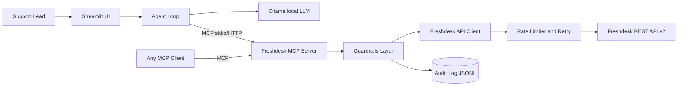

# Architecture

## Layers

- **`src/freshdesk_mcp/`** is the connector and has no UI or LLM dependency. `client.py` (Basic auth, retries), `ratelimit.py`, `guardrails.py`, `models.py` (slim and scrub), `tools/` (MCP tools), `server.py` (FastMCP).
- **`agent/`** is one MCP client. `mcp_bridge.py` spawns the server over stdio and exposes only read tools to the model. `triage_agent.py` runs the pipeline. `llm.py` wraps Ollama.
- **`app/streamlit_app.py`** is the UI. The Approve button is the only place `confirm=true` is sent.

## Triage flow

1. Code fetches open tickets via `list_tickets`, then `get_ticket` with conversations.
2. One Ollama call per ticket returns a schema-validated `TriageResult`. On invalid JSON or an unreachable model it retries once, then uses a keyword fallback.
3. Code builds a proposal (private note, `triage-<category>` tag, priority raise only).
4. The human previews (dry run) and approves. The server enforces `WRITE_ENABLED`, dry-run, `confirm`, the field whitelist and the audit log.

## Trust boundaries

Ticket text is untrusted. The LLM can only read and classify. It cannot name a write tool or its arguments. The server does not trust the client either: writes are gated server-side.
